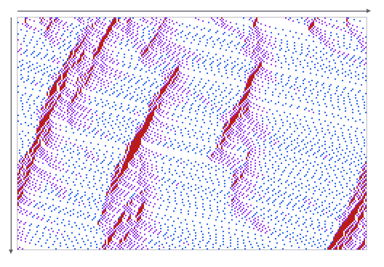

# Бодит хэрэглээ: Cellular automata

Game of Life бол тоглоом шиг харагдах ч гол санаа нь маш практик: **нүд бүр зөвхөн хөршөө хараад, бүгд зэрэг шинэчлэгдэнэ**. Ийм "local дүрэм + зэрэгцээ шинэчлэл" загвар game dev, график, шинжлэх ухаанд өргөн хэрэглэгддэг.

@youtube(R9Plq-D1gEk "Numberphile: John Conway өөрөө Game of Life-ийг хэрхэн зохиосон тухайгаа")

## 🎮 Game development

### Агуй, газрын зураг үүсгэх (procedural generation)

Roguelike болон 2D тоглоомууд агуйн газрын зургийг cellular automaton-оор үүсгэдэг. Алхам нь:

1. Grid-ийг ~45% магадлалтай санамсаргүй хана болгоно.
2. Хэдэн удаа **smoothing** хийнэ: эргэн тойрны 9 нүдний 5+ нь хана бол хана, үгүй бол хоосон.
3. Үр дүн нь байгалийн мэт гөлгөр агуй.

```js
function smooth(grid, W, H) {
  const next = grid.slice();
  for (let y = 0; y < H; y++) for (let x = 0; x < W; x++) {
    let walls = 0;
    for (let dy = -1; dy <= 1; dy++) for (let dx = -1; dx <= 1; dx++) {
      const nx = x + dx, ny = y + dy;
      walls += nx < 0 || ny < 0 || nx >= W || ny >= H ? 1 : grid[ny * W + nx]; // ирмэг = хана
    }
    next[y * W + x] = walls >= 5 ? 1 : 0;
  }
  return next;
}
// let map = random(0.45); for (let i = 0; i < 5; i++) map = smooth(map, W, H);
```

Энэ нь Game of Life-ийн `step()`-тэй яг ижил бүтэц — зөвхөн дүрэм нь өөр.

**Өөрөө туршиж үз** — санамсаргүй дуу чимээ smoothing алхам бүрт агуй болж хувирна:

@live(cave.js "Агуй үүсгэгч: «Шинэ агуй» дарж, ханын хувийг өөрчилж үз")

### Пиксел бүр "амьд" физик — Noita

**Noita** тоглоомд дэлгэцийн пиксел бүр элс, ус, тос, гал, хий гэх мэт материал бөгөөд frame бүрт хөршүүдээсээ хамааран шилждэг: элс доошоо унана, ус хажуу тийш урсана, гал шатамхай хөрш рүү тархана. Энэ бол "falling sand" төрлийн cellular automaton.

@youtube(prXuyMCgbTc "GDC: Exploring the Tech and Design of Noita — пиксел бүрийг хэрхэн simulate хийдэг тухай")

### Гал, ус, ургамлын тархалт

Minecraft зэрэг blocky тоглоомд ус урсах, гал тархах, өвс ургах нь блок бүр хөршүүдээ шалгадаг энгийн local дүрмүүд. Бүх ертөнцийг нэг дор биш, зөвхөн ойр хавийн блокуудыг шинэчилдэг.

## 🖥️ Технологи ба шинжлэх ухаан

### Зураг боловсруулалт ба GPU

Blur, sharpen, edge detection нь пиксел бүрийг **хөршүүдийн жинтэй нийлбэр**-ээр солино (convolution) — Game of Life-ийн хөрш тоолохтой ижил загвар. GPU мянга мянган цөмтэй тул пиксел бүрийг зэрэг бодож чаддаг; Game of Life-ийг ч shader дээр секундэд сая сая нүдээр ажиллуулдаг.

### Замын түгжрэл — Nagel–Schreckenberg загвар

1992 оны энэ загварт зам нь нүднүүдийн мөр, машин бүр урдах машинаасаа хамааран хурдасна, удаашрана. Ийм энгийн дүрмээс ямар ч осолгүйгээр **"phantom traffic jam"** (шалтгаангүй түгжрэл) өөрөө үүсдэг нь бодит замтай таарсан.



### Тархалтын загварчлал

Ойн түймэр, халдварт өвчин (эрүүл → халдвартай → эдгэрсэн) нь нүд бүр хөршөөсөө "халдвар авах" магадлалтай cellular automaton-оор загварчлагддаг.

### Санамсаргүй тоо ба байгаль

- Stephen Wolfram-ийн **Rule 30** гэх нэг хэмжээст automaton-ыг Mathematica санамсаргүй тоо үүсгэхэд ашиглаж байсан.
- *Conus textile* дунгийн хясааны хээ нь Rule 30-тай гайхалтай төстэй — эсүүд хөршөөсөө хамааран пигмент ялгаруулдаг.

## Онол ↔ Бодит амьдрал

| Game of Life дахь ойлголт | Бодит хэрэглээ |
| --- | --- |
| Нүд, төлөв (амьд/үхсэн) | Пиксел материал, блок, машин, хүн (эрүүл/өвчтэй) |
| 8 хөршийг тоолох | Convolution kernel, агуйн smoothing |
| Бүгд зэрэг шинэчлэгдэх | GPU shader, frame бүрийн simulation tick |
| Энгийн дүрмээс нарийн хэлбэр (emergence) | Phantom traffic jam, хясааны хээ |

## 📝 Даалгавар

1. Дээрх `smooth()` функцээр 60 × 40 агуй үүсгэ. Smoothing-ийн давталтын тоог 1, 3, 8 болгоход юу өөрчлөгдөх вэ?
2. Game of Life-ийн дүрмийг **B3/S12345** болгож (амьд үлдэх нөхцлийг өргөтгөж) үз — ямар хэлбэр үүсэх вэ?
3. Түймэр тархах энгийн загвар бич: мод (ногоон) → шатаж буй (улаан) → үнс (саарал). Модны нягтыг өөрчлөхөд түймэр бүх ойд тархах "босго" байна уу?
