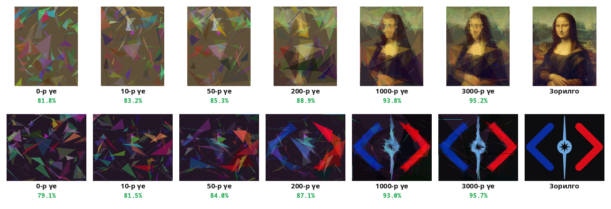

# Genetic Algorithm: Image Evolution

100 өнгөт гурвалжингаар Mona Lisa зурж чадах уу? Хэн ч гараар байрлуулаагүй. Компьютер **мянга мянган зураг "төрүүлж"**, зорилготой хамгийн төстэйг нь үлдээж, тэднээс дахин "хүүхэд" гаргасаар байгаад л ингэж хувирдаг. Байгаль дээрх хувьсалтай яг ижил санаа: **сайн нь үлдэж, үр удмаа үлдээнэ**.



## Энгийнээр хэлбэл

Анги дүүрэн 40 хүүхэд байна гэж төсөөл. Хүн бүр 100 өнгөт гурвалжин наагаад зураг хийнэ. Анхандаа бүгд санамсаргүй толбо.

1. Багш зураг бүрийг **жинхэнэ Mona Lisa-тай харьцуулж** оноо өгнө.
2. Өндөр оноотой хүүхдүүд **"эцэг эх"** болно.
3. Хоёр эцэг эхийн зургаас гурвалжин бүрийг **зоос шидэж** аль нэгээс нь хуулна. Энэ бол шинэ "хүүхэд" зураг.
4. Хааяа нэг гурвалжныг **санамсаргүй жаахан өөрчилнө** (булангаа хөдөлгөх, өнгөө солих).
5. Шинэ 40 зураг гарлаа = **дараагийн үе**. 1-р алхам руу буц.

Хэдэн мянган удаа давтахад толбо аажмаар зураг болдог. Ямар ч ухаан, ямар ч "зураг ойлгох" чадвар байхгүй: **зөвхөн харьцуулж, сайныг нь үлдээж, жаахан өөрчилдөг**.

| Байгаль дээр | Энэ project-д |
| --- | --- |
| Ген | Нэг гурвалжин: 3 булан, өнгө, тунгалаг байдал (10 тоо) |
| DNA | 100 гурвалжны жагсаалт |
| Амьтан (хувь хүн) | Нэг зураг |
| Популяц | 40 зураг |
| Байгальд тохирох чадвар (fitness) | Зорилготой хэр төстэй вэ (%) |
| Үе (generation) | Нэг давталт |
| Үр төл | Хоёр зургаас хольж гаргасан шинэ зураг |

## Томьёо — алхам алхмаар

### 1. Fitness — пикселийн ялгааны квадрат

Зургийг жижигрүүлж (≈64 пиксел) пиксел бүрийн өнгийг зорилготой харьцуулна:

$$
E = \sum_{\text{пиксел}} (\text{зураг} - \text{зорилго})^2
$$

$E$ бага байх тусам сайн. Хүнд ойлгомжтой болгохын тулд хувиар харуулна ($N$ = харьцуулсан тоонуудын тоо: пиксел × өнгөний суваг, 255 = нэг тооны хамгийн их ялгаа):

$$
\text{ижил төстэй} = 1 - \frac{\sqrt{E / N}}{255}
$$

**Жишээ:** 2 пиксел саарал зураг. Зорилго = `[200, 50]`.

| Зураг | Пиксел | Ялгаа | $E$ | Ижил төстэй |
| --- | --- | --- | --- | --- |
| A | `[180, 50]` | 20, 0 | $20^2 + 0^2 = 400$ | $1 - \sqrt{200}/255 =$ **94.5%** |
| B | `[100, 60]` | 100, 10 | $100^2 + 10^2 = 10100$ | $1 - \sqrt{5050}/255 =$ **72.1%** |

A илүү сайн. **Яагаад квадрат?** Том алдаа илүү "өвддөг": 20-ийн алдаа → 400, харин 100-ийн алдаа → 10 000 (5 дахин том алдаа 25 дахин их торгууль).

### 2. Selection — tournament (тэмцээн)

Популяцаас **санамсаргүй 3** зураг аваад хамгийн сайныг нь эцэг эх болгоно.

**Жишээ:** 40 зурагтай популяц. Хамгийн шилдэг зураг нэг тэмцээнд ялах магадлал = 3 оролцогчийн нэг нь өөрөө байх магадлал:

$$
1 - \left(\tfrac{39}{40}\right)^3 \approx 7.3\%
$$

Энгийн "40-өөс нэгийг сугалах" бол 2.5% байх байсан. Тэгэхээр шилдэг нь **≈3 дахин олон** эцэг эх болно. Харин хамгийн муу зураг гурвуулаа өөрөө таарвал л ялна: $(1/40)^3 \approx 0.0016\%$. Сайн нь давуу, гэхдээ дунд зэргийнх ч боломж авдаг тул **олон янз байдал** хадгалагдана.

### 3. Crossover — зоос шидэх

Хүүхдийн гурвалжин бүр A эсвэл B эцэг эхээс 50/50 магадлалтай ирнэ.

**Жишээ:** 4 гурвалжинтай бол

```text
Эцэг эх A:  A1  A2  A3  A4
Эцэг эх B:  B1  B2  B3  B4
Зоос:        A   B   B   A
Хүүхэд:     A1  B2  B3  A4
```

A зургийн зүүн дээд хэсэг сайн, B-гийн доод хэсэг сайн байвал хүүхэд **хоёулангийнх нь сайн хэсгийг** авах боломжтой.

### 4. Mutation — жаахан өөрчлөлт

Гурвалжин бүр **1.5%** магадлалтайгаар өөрчлөгдөнө: булан хөдлөх (45%), өнгө солигдох (35%), бүр шинэ гурвалжин (10%), тунгалаг байдал (10%).

**Жишээ:** 100 гурвалжин × 1.5% = дунджаар **1.5 гурвалжин** өөрчлөгдөнө. Нэг ч өөрчлөлтгүй хүүхэд гарах магадлал:

$$
0.985^{100} \approx 22\%
$$

Mutation-гүй бол хэзээ ч **шинэ** зүйл гарахгүй: зөвхөн хуучин гурвалжнуудаа хольж байх болно.

### 5. Elitism — шилдгийг хадгалах

Хамгийн сайн 2 зураг **өөрчлөгдөхгүйгээр** дараагийн үе рүү шууд орно. Тиймээс шилдгийн оноо **хэзээ ч буурахгүй**: demo-ийн ногоон шугам зөвхөн өсдөг.

### Яагаад ажилладаг вэ?

Нэг гурвалжин 10 тоо, 100 гурвалжин бол 1000 тоо. Санамсаргүй таавал Mona Lisa олдох магадлал тэг. Харин GA **өмнөх сайн зургаас** эхэлж, өөрчлөлт бүрийг шалгаж, муу бол хаядаг. Нэг алхам бүр жижиг ч олон мянган алхам нийлээд зураг болно.

CS лого дээр нэг туршилт (100 гурвалжин, 40 популяц):

| Үе | 0 | 10 | 50 | 200 | 1000 | 3000 |
| --- | --- | --- | --- | --- | --- | --- |
| Ижил төстэй | 79.1% | 81.5% | 84.0% | 87.1% | 93.0% | 95.7% |

0-р үе ч 79% байгаа нь дэвсгэр нь зорилгын **дундаж өнгө** учраас. Эхэндээ хурдан, дараа нь удааширдаг: том алдаануудыг хурдан засаад, нарийн хэсгүүд удаан.

### Тохиргоо чухал

Туршилт (CS лого, 2000 үе, 4 өөр санамсаргүй эхлэл):

| Тохиргоо | Үр дүн |
| --- | --- |
| Crossover **асаалттай** | 94.7 – 95.5% |
| Crossover **унтраалттай** (зөвхөн mutation) | 93.5 – 94.1% |

Mutation-ийн хэмжээ "алтан дундаж"-тай (нэг туршилт):

| Mutation | 0.2% | **1.5%** | 10% |
| --- | --- | --- | --- |
| 2000-р үе | 92.8% | **94.7%** | 89.4% |

Хэт бага: шинэ санаа ховор → удаан. Хэт их: сайн зургийг ч эвдэх нь ихэснэ.

### 6. Олон янз байдал (diversity) ба арлууд

Популяц хэр олон янз вэ гэдгийг хэмжье: популяцаас **хоёр зураг** аваад **хэдэн хувь гурвалжнаараа ялгаатай** вэ гэдгийг тоолно, бүх хосоор дундажлана.

$$
\text{олон янз байдал} = \text{хос бүрийн ялгаатай гурвалжны хувийн дундаж}
$$

**Жишээ:** 4 гурвалжинтай 3 зураг.

```text
Зураг 1:  a  b  c  d
Зураг 2:  a  b  c  e      1–2: 1 ялгаатай  → 25%
Зураг 3:  a  f  c  e      1–3: 2 ялгаатай  → 50%,  2–3: 1 ялгаатай → 25%
```

Дундаж = (25 + 50 + 25) / 3 ≈ **33%**.

Demo-ийн ягаан шугам: энгийн GA-д хэдэн зуун үеийн дараа **≈10–15%** болж буурдаг. Бараг бүгд нэг зургийн хуулбар болж, crossover бараг юу ч хольж чадахгүй. Үүнийг **эрт нэгдэх** (premature convergence) гэдэг.

**Арлууд (island model):** популяцыг 4 тусдаа "арал" болгоно. Эцэг эх хоёулаа нэг арлаас л сонгогдоно. 50 үе тутамд арал бүрийн шилдэг нь дараагийн арал руу "аялж", тэндхийн хамгийн мууг солино. Арал бүр өөрийн замаар хувьсдаг тул олон янз байдал **≈55–70%** хэвээр үлддэг (CS лого, 3 туршилт).

Гэхдээ олон янз байдал өөрөө зорилго биш: энэ зураг дээр арлуудтай GA-гийн оноо энгийн GA-тай **ойролцоо эсвэл арай доогуур** гарсан (доорх хүснэгт). Олон янз байдал нь олон "хавх"-тай бодлогод л жинхэнэ үнэ цэнтэй.

### Уралдаан: GA үргэлж ялах уу?

Шударга харьцуулахын тулд **үе биш, зурж шалгасан зургийн тоогоор** хэмжинэ (нэг үе = 38 зураг, hill climbing-д нэг алхам = 1 зураг). CS лого, 3 өөр санамсаргүй эхлэл:

| Арга | 80 000 зураг | 300 000 зураг |
| --- | --- | --- |
| Санамсаргүй хайлт (бүр шинэ зураг бүрт) | 79.9 – 80.1% | — |
| GA, crossover-гүй | 93.6 – 94.2% | — |
| GA + 4 арал | 94.4 – 94.8% | 96.9 – 97.4% |
| GA | 94.9 – 95.6% | 96.6 – 97.4% |
| **Hill climbing** (1 зураг, нэг гурвалжин өөрчил, муудаагүй бол үлдээ) | **97.0 – 97.2%** | **97.6 – 98.1%** |

Энэ зураг дээр **hill climbing түрүүлдэг!** Энэ нь GA муу гэсэн үг биш, харин **бодлого бүрт тохирох багаж** өөр гэсэн үг:

- **Санамсаргүй хайлт** өмнөх амжилтаа ашигладаггүй тул хэзээ ч сайжрахгүй. "Сайныг нь үлдээх" нь бүх зүйл.
- **Hill climbing** = популяц нь **1** GA. Зураг "гөлгөр" бодлого: жижиг өөрчлөлт бүр жаахан сайжруулалт өгдөг, ганц том толгод руу авирахтай адил. Тийм үед 40 зураг зэрэг хадгалах нь хүчээ 40 хуваахтай адил. (Нэг туршилтаар популяцыг 10 болгоход GA hill climbing-д ойртсон: 80 000 зурагт 96.5%.)
- **GA хэзээ илүү вэ?** Олон жижиг толгодтой (хавхтай) бодлогод нэг авирагч эхний толгод дээрээ гацдаг, популяц олон газар зэрэг хайна. Crossover өөр өөр шийдлийн сайн хэсгийг нийлүүлж чадна. Мөн 40 зургийг **40 компьютер дээр зэрэг** шалгаж болно, hill climbing дараалан л явна.

## Demo дээр туршаад үз

- **CS лого** эсвэл **Mona Lisa** сонгоод ажиглаарай: эхэлж өнгөт толбо, 200 орчим үед хэлбэр, 1000 орчим үед танигдахуйц болно. Доорх **"Шилдэг нь хэрхэн өөрчлөгдсөн бэ"** мөрөнд үе үеийн зургууд үлдэнэ.
- **Гурвалжнуудыг харуулах**-ыг асаа. Зураг үнэхээр **зөвхөн гурвалжнууд**: ид шид алга.
- **Алдаа хаана байна** зураг: гэрэлтэй пиксел = зорилгоосоо хол. Хувьсал явах тусам гэрэл ирмэгүүд рүү шахагдаж, аажмаар бүдгэрнэ. Fitness гэдэг яг энэ гэрлийн нийлбэр.
- **Олон янз байдал** (ягаан шугам): хэдэн зуун үеийн дараа ≈10% болж унахыг хар. Дараа нь **Арал = 4** дар: шугам ≈60% руу өгсөж, популяцын зургууд 4 өнгөөр бүлэглэгдэнэ.
- **3. Уралдаан** таб: эхлүүлэхээсээ өмнө аль нь ялахыг таамагла! Дөрвөн арга ижил тооны зураг зурна. Хамгийн эхний хэдэн зуун зурагт GA тэргүүлдэг (40 санамсаргүй зургийн шилдгээс эхэлдэг тул), гэхдээ 1000 зураг хүрэхээс өмнө hill climbing гүйцэж түрүүлдгийг хар.
- **2. Нэг үе дотор** таб: tournament-ийн 3 оролцогч, эцэг эх A, B-гийн DNA, хүүхэд аль хэсгийг хэнээс авсан, аль гурвалжин mutation-д орсон. Хайрцаг дээр хулганаар очвол тэр гурвалжин шараар тодорно. **🎲 Өөр хос** дарж олон удаа үз: ихэнх хүүхэд эцэг эхээсээ **муу** гардаг!
- **Crossover**-ийг унтраагаад **↺ Шинээр** дар: график арай удаан өсөхийг хар.
- **Mutation**-ийг 10% болго: шилдэг нь удаан өсдөг; 0.2%: бас удаан.
- **Популяц** 10 ба 100-г харьцуул: бага бол үе бүр хурдан ч олон янз байдал бага.
- **⬆ Өөрийн зураг**: өөрийн зураг, лого оруулж үз. Энгийн, том хэлбэртэй зураг хамгийн сайн гардаг.

## Нэг санаа авч үлдэх

> **Сайныг нь сонгох + хольж хослуулах + жаахан санамсаргүй өөрчлөх, үүнийг олон удаа давтах.** "Яаж хийхийг" мэдэхгүй ч "сайн уу, муу юу" гэдгийг хэмжиж чадвал энэ арга шийдлийг өөрөө олдог. Гэхдээ энэ нь ид шидийн түлхүүр биш, нэг багаж: уралдаан дээр харсанчлан заримдаа илүү энгийн арга ялдаг. NASA-гийн антен, хуваарь гаргах, тоглоомын AI, байгаль дээрх амьтад бүгд энэ зарчим.

## Код (C++)

Гурвалжин зурах код урт болох тул энд **8×8 саарал зураг** (инээмсэглэл) хувьсгана. Ген = нэг пикселийн өнгө. Fitness, tournament, crossover, mutation, elitism бүгд demo-тойгоо ижил:

```cpp
#include <algorithm>
#include <cmath>
#include <cstdio>
#include <random>
#include <string>
#include <vector>
using namespace std;

// Зорилго: 8×8 саарал зураг (0 = хар, 255 = цагаан) — инээмсэглэл.
const vector<string> SMILE = {
    "..####..",
    ".#....#.",
    "#.#..#.#",
    "#......#",
    "#.#..#.#",
    "#..##..#",
    ".#....#.",
    "..####..",
};
const int N = 64;                        // ген = нэг пикселийн өнгө (0..255)
const int POP = 40, ELITE = 2;
const double RATE = 0.03;                // пиксел бүр 3% магадлалтай mutation

mt19937 gen(42);
double rnd() { return gen() / 4294967296.0; }            // 0 ≤ x < 1, бүх компьютер дээр ижил

struct Pic { vector<double> px; double err; };
vector<double> target(N);

double error(const vector<double>& px) {                 // ялгааны квадратын нийлбэр
    double e = 0;
    for (int i = 0; i < N; i++) e += (px[i] - target[i]) * (px[i] - target[i]);
    return e;
}
double similarity(double err) { return 1 - sqrt(err / N) / 255; }

const Pic& tournament(const vector<Pic>& pop) {          // санамсаргүй 3-аас шилдэг нь
    const Pic* best = nullptr;
    for (int k = 0; k < 3; k++) {
        const Pic& c = pop[int(rnd() * pop.size())];
        if (!best || c.err < best->err) best = &c;
    }
    return *best;
}

Pic breed(const Pic& a, const Pic& b) {
    Pic child{vector<double>(N), 0};
    for (int i = 0; i < N; i++) {
        child.px[i] = rnd() < 0.5 ? a.px[i] : b.px[i];                        // crossover: зоос шидэх
        if (rnd() < RATE) child.px[i] = clamp(child.px[i] + (rnd() - 0.5) * 160, 0.0, 255.0);   // mutation
    }
    child.err = error(child.px);
    return child;
}

void show(const Pic& p) {
    const string shade = " .:-=+*#%@";                   // хар → цагаан
    for (int y = 0; y < 8; y++) {
        for (int x = 0; x < 8; x++) { char c = shade[int(p.px[y * 8 + x] / 256 * 10)]; printf("%c%c", c, c); }
        printf("\n");
    }
}

int main() {
    for (int i = 0; i < N; i++) target[i] = SMILE[i / 8][i % 8] == '#' ? 255 : 0;

    vector<Pic> pop(POP);
    for (auto& p : pop) {                                // 0-р үе: санамсаргүй саарал толбо
        p.px.resize(N);
        for (auto& v : p.px) v = rnd() * 255;
        p.err = error(p.px);
    }
    auto byErr = [](const Pic& a, const Pic& b) { return a.err < b.err; };

    for (int g = 0; g <= 300; g++) {
        sort(pop.begin(), pop.end(), byErr);
        if (g == 0 || g == 10 || g == 50 || g == 100 || g == 300) {
            double avg = 0;
            for (auto& p : pop) avg += similarity(p.err) / POP;
            printf("%3d-р үе: шилдэг %.1f%%, дундаж %.1f%%\n", g, similarity(pop[0].err) * 100, avg * 100);
        }
        if (g == 0) show(pop[0]);
        vector<Pic> next(pop.begin(), pop.begin() + ELITE);                  // elitism
        while ((int)next.size() < POP) {
            const Pic& a = tournament(pop);              // A-г эхэлж, дараа нь B-г сонгоно
            const Pic& b = tournament(pop);
            next.push_back(breed(a, b));
        }
        pop = next;
    }
    sort(pop.begin(), pop.end(), byErr);
    show(pop[0]);
}
```

Гаралт: санамсаргүй толбо → инээмсэглэл.

```text
  0-р үе: шилдэг 48.3%, дундаж 41.7%
--**%%====##--%%
==**--++##==++++
::--%%----++++  
@@::**++..==@@--
**##--**....##%%
**==++##%%++##@@
..##--##::####..
  ::++####==%%##
 10-р үе: шилдэг 67.4%, дундаж 64.1%
 50-р үе: шилдэг 93.1%, дундаж 91.3%
100-р үе: шилдэг 99.6%, дундаж 98.0%
300-р үе: шилдэг 100.0%, дундаж 97.9%
    @@@@@@@@    
  @@        @@  
@@  @@    @@  @@
@@            @@
@@  @@    @@  @@
@@    @@@@    @@
  @@        @@  
    @@@@@@@@    
```

300 үед зорилгоо бүрэн олсон. Хэн ч "нүд энд, ам тэнд" гэж зааж өгөөгүй: зөвхөн **"зорилгоос хэр хол байна"** гэдгийг хэмжсэн. `mt19937`-ийн гаргах тоо C++ стандартаар тогтсон тул ямар ч компьютер дээр яг ийм гаралт гарна. Demo-ийн бүтэн код: [demo.js](demo.js).
