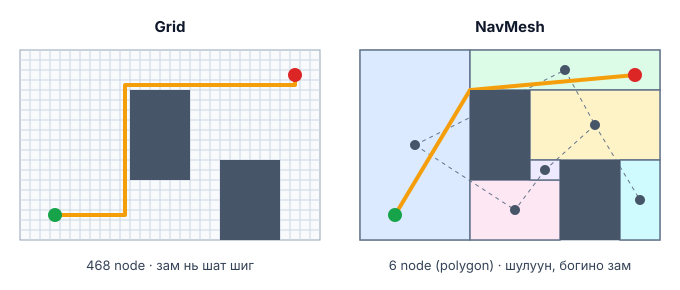
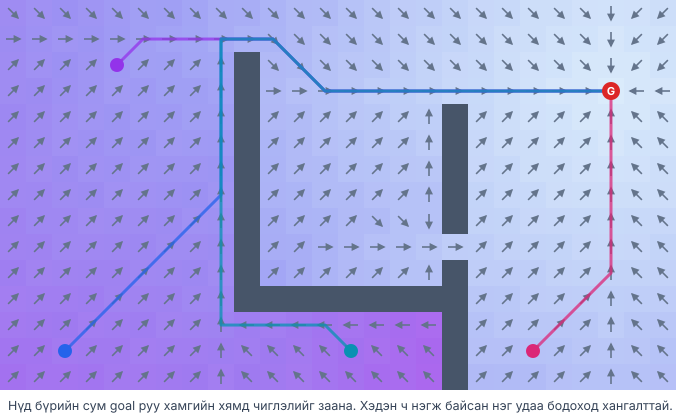

# Бодит хэрэглээ: Pathfinding ба graph search

Demo дээр grid-ийн нүд бүр node байсан. Бодит амьдралд **node** нь хот, router, хүн, файл, тоглоомын өрөө — юу ч байж болно. Тиймээс BFS, Dijkstra, A* нь газрын зургаас эхлээд интернэт, social network, compiler хүртэл хаа сайгүй ажилладаг.

## 🎮 Game development

### Нэгжүүдийг хөдөлгөх — A* ба NavMesh

Strategy, RPG, shooter тоглоомд дүр бүр "энд дарсан газар руу хана мөргөлгүй оч" гэх командыг A*-аар биелүүлдэг. Гэхдээ бодит тоглоом grid биш **NavMesh** ашигладаг:

- Явж болох газрыг том олон өнцөгтүүдээр (polygon) хуваана — node нь нүд биш, polygon.
- A* polygon-уудын graph дээр ажиллаж, дараа нь замыг гөлгөрүүлнэ.
- **Unity NavMesh**, Unreal Engine-ийн navigation (нээлттэй **Recast & Detour** library) ийм.

Grid-ийн 1000 нүдийг 20 polygon орлох тул A* хамаагүй хурдан.



@youtube(-L-WgKMFuhE "Sebastian Lague: A* Pathfinding — algorithm-ийн тайлбар (Unity)")

### Олон нэгж — Flow field

Нэг зэрэг 500 нэгжид A* тус бүрд нь ажиллуулбал удаан. **Supreme Commander 2** зэрэг RTS тоглоомууд **flow field** хэрэглэсэн: goal-оос эхлэн **Dijkstra**-г бүх газрын зураг дээр нэг удаа ажиллуулж, нүд бүрд "хаашаа явах" сум хадгална. Нэгж бүр зөвхөн доорх сумаа дагана.



### Хурдасгах аргууд

- **Jump Point Search** — жигд grid дээр A*-ийн илүүдэл node-уудыг "үсэрч" алгасна (олон дахин хурдан).
- **Hierarchical A\* (HPA\*)** — эхлээд бүсүүдийн түвшинд, дараа нь бүсийн дотор зам хайна.

### Хиймэл оюуны шийдвэр

Шатар, puzzle тоглоомын AI ч graph search: node = тоглоомын байрлал, edge = нүүдэл. Rubik's cube, 15-puzzle-ийг A*-аар (heuristic = буруу байрласан хэсгийн тоо) шийддэг.

@youtube(ySN5Wnu88nE "Computerphile: A* Search Algorithm — heuristic хэрхэн тусалдаг")

## 🖥️ Технологи ба системүүд

### Газрын зураг ба GPS

Google Maps, OSRM (OpenStreetMap routing) зэрэг навигац нь замын сүлжээг graph болгодог: уулзвар = node, зам = edge, жин = явах хугацаа (түгжрэл ороод). Сая сая node-той тул энгийн Dijkstra удаан — **Contraction Hierarchies** зэрэг урьдчилсан боловсруулалт хийж, Dijkstra/A*-г миллисекундэд ажиллуулдаг.

@youtube(GazC3A4OQTE "Computerphile: Dijkstra's Algorithm")

### Интернэтийн routing

Router-ууд packet-ийг хаашаа дамжуулахаа шийдэхдээ graph search хийдэг. **OSPF** protocol нь router бүр сүлжээний бүтэн зургийг мэдэж, **Dijkstra**-ийн "shortest path first" algorithm-аар бусад бүх router хүртэлх хамгийн хямд замыг тооцдог.

### Social network

"Танай найзын найз" (2nd connection) бол **BFS**-ийн 2-р давхарга. LinkedIn-ийн "1st, 2nd, 3rd" зэрэглэл яг BFS-ийн зай.

```js
// BFS: хэдэн "гар дамжиж" танилцах вэ?
function degrees(friends, from, to) {
  const dist = new Map([[from, 0]]), queue = [from];
  while (queue.length) {
    const u = queue.shift();
    if (u === to) return dist.get(u);
    for (const v of friends.get(u) ?? [])
      if (!dist.has(v)) { dist.set(v, dist.get(u) + 1); queue.push(v); }
  }
  return Infinity;
}
```

### Developer-ийн өдөр тутмын хэрэгсэл

- **Package manager** (`npm install`, `pip`) — dependency-ийн graph-ийг DFS-ээр явж, юуг эхэлж суулгахыг (topological order) тодорхойлно.
- **Garbage collector** — "root"-оос DFS/BFS-ээр хүрч болох объектуудыг тэмдэглээд, хүрч болохгүйг нь устгана (mark & sweep).
- **Web crawler** — хуудаснаас link-ээр BFS хийж интернэтийг индексжүүлнэ.

### Робот

Робот тоос сорогч, агуулахын робот, ROS-ийн navigation stack нь газрын зургийг cost grid болгоод **Dijkstra / A\***-аар зам төлөвлөнө — яг demo шиг, харин "шавар" нь хивс, босго.

## Онол ↔ Бодит амьдрал

| Demo дахь ойлголт | Бодит хэрэглээ |
| --- | --- |
| Grid-ийн нүд | NavMesh polygon, уулзвар, router, хэрэглэгч |
| Хана | Барилга, хаалттай зам, унтарсан холболт |
| Шавар ×5 (жинтэй нүд) | Түгжрэл, хурдны хязгаар, сүлжээний latency |
| Heuristic $h(n)$ | Шулуун зай (GPS), буруу байрласан хэсэг (puzzle) |
| BFS | Social network-ийн зэрэг, web crawler |
| Dijkstra | OSPF routing, flow field |
| A* | Тоглоомын нэгж, GPS, робот |

## 📝 Даалгавар

1. Demo дээр **Maze** үүсгээд 5 algorithm-ийн "задалсан node"-ийг харьцуул. Лабиринтад A*-ийн давуу тал яагаад багасдаг вэ?
2. Хотын 6 дүүргийн хооронд замын хугацаатай жижиг graph зур, Dijkstra-г гараараа ажиллуул.
3. Дээрх `degrees()` функцээр өөрийн 10 найзын жижиг network дээр "хэдэн гар дамжих" зайг ол.
