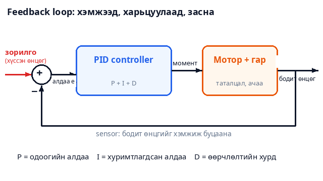
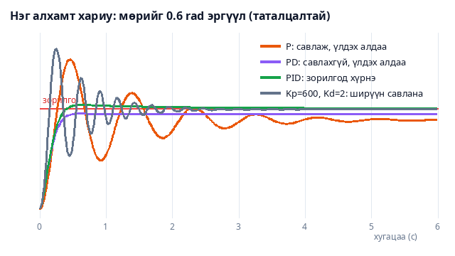

# Control Theory: Robot Arm

Робот гар аяга барихдаа яагаад сэгсэрдэггүй вэ? Яагаад хүнд зүйл өргөхөд суларч доошоо унадаггүй вэ? Хариулт нь **control theory** (удирдлагын онол) — "хүссэн зүйл болоогүй бол яг хэр хүчтэй засах вэ" гэдгийг тооцоолох шинжлэх ухаан. Энэ project-д 3D робот гарын үе бүрийг **PID controller**-оор удирдаж, 3 тоог (Kp, Ki, Kd) өөрчлөхөд юу болохыг харна.

## Энгийнээр хэлбэл — шүршүүрийн ус

Шүршүүрт орсон. Ус хүйтэн. Та халуун усны цорготой **хэр их** хурууны дарна?

- **P — одоогийн алдаа:** Хэтэрхий хүйтэн бол ихээр эргүүлнэ, бага зэрэг хүйтэн бол жаахан. Алдаатай **пропорциональ**.
- **D — хурдыг харах:** Ус халж *хурдан* дулаарч байвал "одоо л зогсооё" гэж тормозлоно, тэгэхгүй бол хэт халуун болно. Алдаа хэр хурдан өөрчлөгдөж байгааг харна.
- **I — санах ой:** Жаахан хүйтэн хэвээр удаан байвал "болохгүй байна" гэж бодоод аажмаар илүү эргүүлнэ. Үлдэж буй алдааг **цуглуулна**.

Эдгээр гурвыг нийлүүлсэн нь **PID**. Робот гарт яг ийм: хүссэн өнцөг (зорилго), бодит өнцөг (sensor), хоёрын зөрүү (алдаа) → моторын момент.



Ийм хэмжээд, харьцуулаад, засдаг гогцоог **feedback** (эргэх холбоо) гэдэг. Cruise control, термостат, дрон, лифт — бүгд ингэж ажилладаг.

## Томьёо — алхам алхмаар

$$
u = K_p \cdot e + K_i \cdot \int e\,dt - K_d \cdot \dot{y}
$$

- $e$ = зорилго − бодит утга (алдаа)
- $\int e\,dt$ = алдааны **нийлбэр** (хугацааны дагуу цуглуулсан)
- $\dot{y}$ = бодит утга хэр хурдан өөрчлөгдөж байна (хурд)
- $u$ = моторт өгөх момент

**Жишээ.** Зорилго = 10, $K_p = 2,\ K_i = 1,\ K_d = 0.5$. Бодит утга 4 → 7 → 9 → 10 гэж өөрчлөгдсөн. Алхам бүр 1 секунд:

| Алхам | $y$ | $e$ | $P = 2e$ | $I = \sum e$ | $D = -0.5 \cdot \text{хурд}$ | $u$ |
| --- | --- | --- | --- | --- | --- | --- |
| 0 | 4 | 6 | 12 | 6 | 0 | **18** |
| 1 | 7 | 3 | 6 | 9 | −1.5 | **13.5** |
| 2 | 9 | 1 | 2 | 10 | −1 | **11** |
| 3 | 10 | 0 | 0 | 10 | −0.5 | **9.5** |

Дөрвөн ажиглалт:

1. Алдаа том үед **P хамгийн хүчтэй** (12 → 6 → 2).
2. Зорилго руу хурдан ойртох үед **D** сөргөөр түлхэж тормозлоно (−1.5).
3. **3-р алхмыг хар!** Алдаа 0 болсон ч $u = 9.5$ **хэвээр**. P = 0 болсон ч **I = 10** санаж байна. Хэрэв таталцал гарыг 10 Н·м-ээр доошоо татаж байвал яг энэ санасан момент гарыг дээр барьж байна.
4. Тиймээс I нь "үргэлж байдаг хүчийг" сурч, хэзээ ч алдаа үлдээхгүй.

## 1. Яагаад зөвхөн P хангалтгүй вэ — таталцал

Гар зорьсон өнцөгтөө хүрэхэд P-ийн момент $K_p \cdot e$ нь 0 рүү буурна. Гэтэл гарыг тэр өнцөгт барихад таталцлыг эсрэглэх момент **заавал** хэрэгтэй! Тиймээс гар жаахан доошоо хазайж, алдаа үлдэж, P тэр алдаагаас момент гаргана:

$$
\text{үлдэх алдаа} = \frac{\text{таталцлын момент}}{K_p \cdot J}
$$

**Жишээ.** Таталцал 10 Н·м, $K_p = 50$, инерци $J = 1$: үлдэх алдаа $= 10 / 50 =$ **0.2 рад** (≈ 11°). Зорилго 1.0 бол гар 0.8-д зогсоно.

Үлдэх алдааг багасгахын тулд $K_p$-г ихэсгэж болно, гэвч хэт ихэсгэвэл гар **савлаж** эхэлнэ. I нь үүнийг шийддэг: алдаа үлдэж байвал I үргэлжлүүлэн өсөөд, эцэст нь алдааг яг 0 болгоно.

## 2. Савлалт ба D

Зөвхөн P-тэй гар **пүрш**-тэй адил: зорилгоос холдвол буцааж татаж, зорилгод хүрэхэд хурдтай ирсэн тул хэтэрч, дахин буцна... Үүнийг **overshoot** гэдэг.

D нь **тоормос** (амортизатор): гар хурдан хөдөлж байвал эсрэг түлхэнэ. Савлалт арилна.

Хариултыг гурван тоогоор үнэлнэ:

| Үзүүлэлт | Утга | Жишээ |
| --- | --- | --- |
| **Overshoot** | Зорилгоос хэтэрсэн хэмжээ ÷ нийт алхам × 100 | 0 → 1 алхамд оргил 1.3 бол **30%** |
| **Тогтох хугацаа** | Хариу зорилгын ±2%-д орж үлдэх хүртэл | Алдаа 0.02-оос бага болох хугацаа |
| **Үлдэх алдаа** | Эцэст нь зорилгоос зөрөх хэмжээ | Таталцлын жишээнд 0.2 рад |

Хамгийн сайн controller: **overshoot бага, хурдан тогтоно, үлдэх алдаа 0**.



Энэ зураг demo-ийн жинхэнэ симуляциас гарсан: мөрийг 0.6 рад эргүүлэхэд P, PD, PID хэрхэн ялгаатай хариулахыг харуулна.

## 3. Гарын геометр — inverse kinematics

Гарыг "энэ цэг рүү очи" гэж хэлэхэд үе бүр хэдэн градус болох вэ? Хоёр үет гарын (урт $L_1, L_2$) хувьд косинусын теоремоор:

$$
\cos q_2 = \frac{d^2 - L_1^2 - L_2^2}{2 L_1 L_2}
$$

$d$ нь мөрнөөс зорилго хүртэлх зай. Тохойн өнцгийг олсны дараа мөрийнхийг гурвалжингаар олно.

**Жишээ.** $L_1 = L_2 = 1$, зорилго мөрнөөс баруун 1, дээш 1 хэмжээнд. $d^2 = 1^2 + 1^2 = 2$:

$$
\cos q_2 = \frac{2 - 1 - 1}{2} = 0 \;\Rightarrow\; |q_2| = 90°
$$

Мөр босоо дээшээ ($q_1 = 90°$), тохой 90° нугалж ($q_2 = -90°$) хоёр дахь холбоосыг хэвтээ болгоно. Шалгая: мөрийн төгсгөл $(0, 1)$, хоёр дахь холбоос баруун тийш 1 → төгсгөл **(1, 1)** ✓.

Demo дээр хавтгайд дарахад хөдөлгөөн яг ингэж бодогдоно: суурь (yaw) зорилгын чиглэлийг, мөр + тохой зайг, бугуй атгагчийг **доош** харуулна.

## 4. Pick & place — алхам алхмаар

**▶ Pick & place** нь гарыг 8 алхамаар удирдана:

1. Бөмбөгний дээгүүр очих → 2. доош бууж → 3. атгагчийг хаах → 4. өргөх → 5. байршуулах газрын дээгүүр → 6. доош буулгах → 7. атгагчийг нээх → 8. дээш гарах.

Алхам бүрийн төгсгөлд гар **бүрэн тогтсон** (хурд ≈ 0, алдаа < 1.2 см) байх ёстой, үгүй бол дараагийн алхам руу шилжихгүй. Controller муу бол (P, PD) таталцлаас болж хэдэн см доош зөрж, бөмбөгийг барьж чадахгүй.

### Windup — I-ийн хор

Атгагч бөмбөгийг шахаж байхад хаагдах боломжгүй: алдаа удаан үлддэг. I нь тэр алдааг **секунд бүр цуглуулсаар** хэмжээлшгүй том болдог (**integral windup**). Бөмбөгийг тавьж нээхэд тэр цуглуулсан зүйлээ буцааж "тайлах" хүртэл олон секунд хүлээнэ. Тиймээс энэ demo-д атгагч зөвхөн PD-тэй, мөн гар дахь I нь моторын хязгаарт хүрсэн үед цуглуулахаа зогсооно (anti-windup).

## Demo дээр туршаад үз

- **Controller:** **P** сонго. Гараа шалан дээр дарж илгээ — гар савлаж, дараа нь зорилгоос доор зогсоно. Графикт **улаан тасархай** зорилго, **цэнхэр** бодит; доорх тоонд overshoot, үлдэх алдаа улаан.
- **PD** — савлалт алга боллоо. Гэвч үлдэх алдаа хэвээр.
- **PID** — алдаа 0. Тогтох хугацаа ~1.3 с.
- **Хэт их Kp** — ширүүн савлана. **Хэт сул** — удаан.
- **Таталцал**-ыг унтрааж P-г дахин үз: үлдэх алдаа **алга болно** (таталцал л шалтгаан байсан).
- **🏋 Ачаа 1.5 кг** — гар хүнд зүйл барьж байна. PD-д алдаа нэмэгдэнэ, PID-д дахин 0 болно (I дахин "сурна").
- **👉 Түлхэх** — гарыг гэнэт түлхэж, controller хэр хурдан сэргээхийг үз.
- **График** дээрх өөр үе (Суурь, Тохой, Бугуй, Атгагч) сонгож харьцуул.
- **▶ Pick & place**-ийг PID-ээр, дараа нь P-ээр ажиллуул. P-ээр бөмбөгийг барьж чадахгүй — "Атгагч бөмбөгөөс N см зайтай" гэж хэлнэ. **¼ хурд** асааж нарийн харна.

## Нэг санаа авч үлдэх

> **Хэмж → харьцуул → зас → дахин.** P одоогийн алдааг, D хурдыг (савлалтыг), I үлдэж буй алдааг (таталцал зэрэг) удирдана. Дрон, лифт, cruise control, робот — бүгд энэ гогцоо.

## Код (C++)

**1. PID-ийн нэг алхам** — дээрх хүснэгттэй яг ижил:

```cpp
#include <iostream>
using namespace std;

int main() {
    // PID-ийн гар тооцоолол: зорилго 10, Kp = 2, Ki = 1, Kd = 0.5, алхам бүр dt = 1
    double Kp = 2, Ki = 1, Kd = 0.5, target = 10, dt = 1;
    double measured[] = {4, 7, 9, 10};         // мотор тус бүрт хэмжигдсэн утга
    double integral = 0, prev = measured[0];

    for (int step = 0; step < 4; step++) {
        double y = measured[step];
        double e = target - y;                  // алдаа
        integral += e * dt;                     // алдааны нийлбэр
        double speed = (y - prev) / dt;         // хэмжсэн утга хэр хурдан өөрчлөгдөж байна
        double P = Kp * e, I = Ki * integral, D = speed == 0 ? 0 : -Kd * speed;
        cout << "алхам " << step << ": y=" << y << "  e=" << e
             << "  P=" << P << "  I=" << I << "  D=" << D << "  -> u=" << P + I + D << "\n";
        prev = y;
    }
}
```

Гаралт: `u = 18`, `13.5`, `11`, `9.5`.

**2. Таталцалтай нэг үе — P, PD, PID харьцуулалт.** Нэг үеийг Ньютоны хуулиар загварчилж (инерци, үрэлт, таталцал), гурван controller-ийг ижил зорилгод ажиллуулна:

```cpp
#include <algorithm>
#include <cmath>
#include <iostream>
using namespace std;

// Нэг үе: J·θ'' = момент - b·θ' - таталцал.  Таталцал үргэлж доошоо 10 Н·м-ээр татна.
double simulate(double Kp, double Ki, double Kd, double target, double seconds) {
    const double J = 1.0, b = 0.5, gravity = 10.0, dt = 0.001;
    double angle = 0, speed = 0, integral = 0;
    for (double t = 0; t < seconds; t += dt) {
        double e = target - angle;
        integral += e * dt;
        double torque = J * (Kp * e + Ki * integral - Kd * speed);   // PID
        torque = clamp(torque, -60.0, 60.0);                          // моторын хязгаар
        double accel = (torque - b * speed - gravity) / J;            // Ньютоны хуулийн
        speed += accel * dt;
        angle += speed * dt;
    }
    return angle;
}

int main() {
    cout << "Зорилго = 1.0 рад\n";
    cout << "P   (Kp=50)            : " << simulate(50, 0, 0, 1.0, 10) << "\n";
    cout << "PD  (Kp=50, Kd=10)     : " << simulate(50, 0, 10, 1.0, 10) << "\n";
    cout << "PID (Kp=50, Ki=40, Kd=10): " << simulate(50, 40, 10, 1.0, 10) << "\n";
}
```

Гаралт: P → `0.7977`, PD → `0.8`, PID → `0.999999`. P, PD хоёр яг дээрх 1-р хэсгийн томьёо ($10 / 50 = 0.2$ рад дутуу) хэмжээгээр доор зогсож, **зөвхөн PID** зорилгод хүрнэ. Demo-ийн бүтэн код (5 үе, 3D, inverse kinematics): [demo.js](demo.js).
