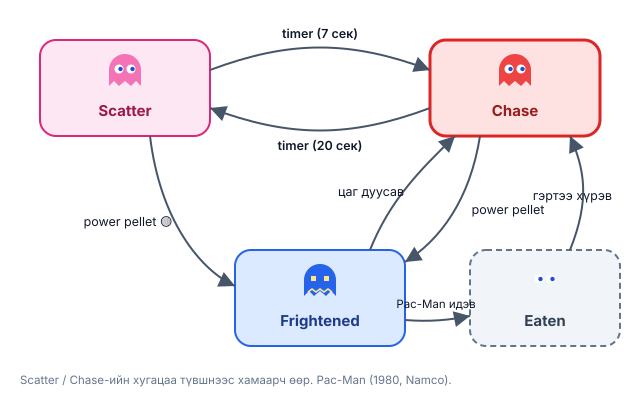
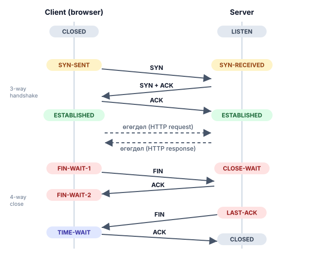

# Бодит хэрэглээ: State machine

Demo дахь bot "Patrol → Chase → Attack" гэж шилждэг байсан. Бодит программд ч асуулт ижил: **"одоо ямар төлөвт байна, ямар event ирвэл хаашаа шилжих вэ?"** State machine-гүй бол код `if (isLoading && !hasError && wasClicked ...)` гэх мэт тоо томшгүй boolean-д живдэг.

## 🎮 Game development

### Pac-Man-ийн сүнснүүд

1980 оны **Pac-Man**-ий сүнс бүр state machine:

- **Chase** — Pac-Man-ийг хөөнө (сүнс бүр өөр стратегитай)
- **Scatter** — хэсэг хугацаанд өөрийн буланд буцна (тоглогчид амьсгаа авах зай)
- **Frightened** — том цэг идэхэд цэнхэр болж, санамсаргүй зугтана
- **Eaten** — нүд нь л үлдэж, гэр лүүгээ буцна

Chase ↔ Scatter нь timer-ээр, Frightened нь "power pellet идсэн" event-ээр шилждэг — яг demo дахь bot шиг.



@youtube(ataGotQ7ir8 "Retro Game Mechanics Explained: Pac-Man Ghost AI — сүнс бүр хаашаа явахаа хэрхэн шийддэг")

### Unity Animator

Unity-ийн **Animator Controller** бол дүрслэлтэй state machine: `Idle`, `Walk`, `Run`, `Jump` төлвүүд, тэдгээрийн хоорондох шилжилт нь нөхцөлтэй (`speed > 0.1`, `isGrounded == false`). Demo дахь **Any State** ч Unity-д яг ижил нэртэй — "аль ч төлвөөс `Die` руу".

### Тоглоомын урсгал

Бараг бүх тоглоом дээд түвшиндээ state machine: `MainMenu → Loading → Playing ⇄ Paused → GameOver → MainMenu`. Төлөв бүр өөрийн input, UI, update логиктой.

### F.E.A.R. — "Three States and a Plan"

2005 оны **F.E.A.R.** тоглоомын AI маш ухаалаг гэж алдаршсан. Jeff Orkin-ийн тайлбарласнаар дайснуудын state machine ердөө **3 төлөвтэй** (`Goto`, `Animate`, `UseSmartObject`), харин юу хийхээ **planner** шийддэг. Том тоглоомуудад FSM хэт олон төлөвтэй болохоор **Behavior Tree** (Unreal Engine), **GOAP** руу шилждэг — гэхдээ суурь нь state machine хэвээр.

## 🖥️ Технологи ба системүүд

### TCP холболт

Таны browser сервертэй холбогдох бүрт **TCP** state machine ажилладаг (RFC 793): `CLOSED → SYN-SENT → ESTABLISHED → FIN-WAIT-1 → FIN-WAIT-2 → TIME-WAIT → CLOSED`. Terminal-д `ss -t` эсвэл `netstat` бичихэд эдгээр төлвийг шууд харж болно.



### Regex ба compiler

`grep`, regex engine, compiler-ийн **lexer** нь pattern-ийг automaton (DFA/NFA) болгон хөрвүүлж, тэмдэгт бүрээр нэг алхам шилждэг — demo дахь Turnstile шиг оролтын мөр уншдаг machine.

@youtube(vhiiia1_hC4 "Computerphile: Computers Without Memory — finite state machine-ийн суурь")

### Төлбөр ба захиалга

Онлайн дэлгүүрийн захиалга: `Pending → Paid → Shipped → Delivered` (эсвэл `Cancelled`, `Refunded`). Stripe-ийн PaymentIntent ч `requires_payment_method → processing → succeeded` гэх мэт тодорхой төлвүүдтэй. Хүчингүй шилжилт (жишээ нь `Delivered → Pending`) хийгдэхгүй байх нь state machine-ийн гол давуу тал.

### UI: loading, success, error

Frontend-ийн хамгийн түгээмэл алдаа — "loading болон error зэрэг харагдах". Төлвийг нэг утгаар хадгалбал ийм алдаа гарах боломжгүй:

```js
// Нэг агшинд яг нэг төлөв — boolean-уудын хольц биш.
function reducer(state, event) {
  switch (state.status) {
    case 'idle':    return event.type === 'FETCH'   ? { status: 'loading' } : state;
    case 'loading': return event.type === 'RESOLVE' ? { status: 'success', data: event.data }
                         : event.type === 'REJECT'  ? { status: 'error', error: event.error } : state;
    case 'error':   return event.type === 'RETRY'   ? { status: 'loading' } : state;
    default:        return state;
  }
}
// React: const [state, send] = useReducer(reducer, { status: 'idle' });
```

**XState** зэрэг library-ууд үүнийг graph болгон зурж, тест бичихэд тусалдаг.

### Embedded систем

Лифт, угаалгын машин, автомат худалдааны машин, гэрлэн дохионы контроллер — микроконтроллерт `switch (state)` бүхий давталт хэлбэрээр бичигддэг. Demo дахь Turnstile, Traffic light бол эдгээрийн жижиг хувилбар.

## Онол ↔ Бодит амьдрал

| Demo дахь ойлголт | Бодит хэрэглээ |
| --- | --- |
| Төлөв (Patrol, Locked, Red) | Animator state, TCP state, захиалгын status |
| Event (`s`, `c`, `t`) | Товч дарах, сүлжээний packet, timer, API хариу |
| Шилжилт байхгүй → үл тоомсорлох | Хүчингүй үйлдлийг хаах (`Delivered → Pending` болохгүй) |
| Any state (`*`) | Unity-ийн Any State, "алдаа гарвал аль ч төлвөөс Error руу" |
| Trace | Log, debug, replay |

## 📝 Даалгавар

1. Demo-ийн **Definition засах** хэсэгт Pac-Man-ийн сүнсийг бич: `Chase`, `Scatter`, `Frightened`, `Eaten` ба event-үүд (`t` = timer, `p` = power pellet, `e` = идэгдсэн, `h` = гэртээ ирсэн).
2. Дуу тоглуулагчийн (play / pause / stop / next) state machine зур. Аль шилжилт байх ёсгүй вэ?
3. Terminal-д `ss -tan` ажиллуулж, өөрийн компьютерийн TCP холболтууд ямар төлөвт байгааг хар.
