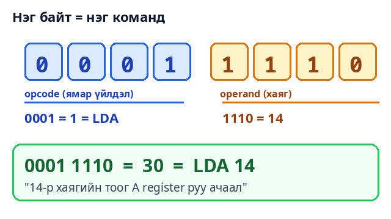

# Tiny CPU

Өмнөх хоёр project-д бид **нэмэгч** (Logic Gates) ба **санах ой** (Memory Circuits) барьсан. Одоо хоёуланг нь нэг газар цуглуулбал юу болох вэ? **Компьютер!** Энэ project-д 8-bit жижиг CPU байна: хэдэн мөр програмыг өөрөө уншиж, нэмж, хасаж, үсэрч, хариугаа гаргана — clock цохилт бүрийг нүдээр харж болно.

## Энгийнээр хэлбэл — тогооч ба жорын ном

Гэртээ хоол хийж байна гэж төсөөл:

| Гал тогоо | CPU |
| --- | --- |
| **Жорын ном** (мөр мөрөөрөө бичсэн) | **RAM** — програмын командууд, тоонууд |
| Хуруугаа тавьсан мөр | **PC** (Program Counter) — "одоо аль команд вэ" |
| Уншсан мөрөө толгойдоо барих | **IR** (Instruction Register) |
| Гарын дээрх зүйл | **A, B register** |
| Тооны машин | **ALU** — нэмэх, хасах (full adder-ууд) |
| Хуруугаа дараагийн мөр рүү шилжүүлэх | **PC + 1** |
| Хоолоо ширээнд тавих | **OUT** |
| Метроном (цохилт) | **CLOCK** |

CPU **юу ч "ойлгодоггүй"**. Тэр ердөө дахин дахин: **(1) мөр уншина → (2) юу хийхийг тодорхойлно → (3) хийнэ → (4) дараагийн мөр рүү**. Үүнийг **fetch – decode – execute** гэдэг.

## 1. Команд бол тоо

RAM-д зөвхөн тоо байдаг. Манай CPU-ийн команд нэг байт (8 bit): **эхний 4 bit = ямар үйлдэл**, **сүүлийн 4 bit = аль хаяг / ямар утга**.



$$
\text{opcode} = \lfloor \text{байт} / 16 \rfloor \qquad \text{operand} = \text{байт} \bmod 16
$$

**Жишээ:** RAM-д `30` гэсэн тоо байна. $30 = 1 \cdot 16 + 14$, тэгэхээр opcode = **1** (`LDA` = "RAM-аас A руу ачаал"), operand = **14**. Энэ бол `LDA 14` — "14-р хаягийн тоог A руу ав".

| Opcode | Команд | Юу хийх вэ |
| --- | --- | --- |
| 1 | `LDA a` | A ← RAM[a] |
| 2 | `ADD a` | A ← A + RAM[a] |
| 3 | `SUB a` | A ← A − RAM[a] |
| 4 | `STA a` | RAM[a] ← A |
| 5 | `LDI v` | A ← v (шууд утга) |
| 6 | `JMP a` | PC ← a (үсрэх) |
| 7 | `JC a` | Carry = 1 бол үсрэх |
| 14 | `OUT` | OUT ← A |
| 15 | `HLT` | зогсох |

4 bit-тэй тул хаяг 0–15 (16 байт RAM) — $2^4 = 16$.

## 2. Нэг командын амьдрал — clock цохилт бүр

Clock цохилт бүрт **яг нэг жижиг алхам** хийгдэнэ (micro-step). `LDA 14` командыг 5 цохилтоор:

| Цохилт | Үе | Юу болох вэ |
| --- | --- | --- |
| T0 | fetch | **MAR ← PC** (хуруу аль мөрөнд байна, түүнийг хаяг болгоно) |
| T1 | fetch | **IR ← RAM[MAR]** (тэр мөрийн командыг уншина) |
| T2 | fetch | **PC ← PC + 1** (хуруугаа дараагийн мөр рүү) |
| T3 | execute | **MAR ← 14** (IR-ийн operand) |
| T4 | execute | **A ← RAM[14]** |

Эхний гурав (fetch) **бүх командад адил**. Сүүлийн хэсэг (execute) командаас хамаарна: `ADD` нэг алхам илүү (B ← RAM, дараа нь A ← A + B), `OUT` ердөө 1 алхам.

**Жишээ — "28 + 14" програм** (`LDA 14`, `ADD 15`, `OUT`, `HLT`):

$$
\text{clock} = \underbrace{5}_{LDA} + \underbrace{6}_{ADD} + \underbrace{4}_{OUT} + \underbrace{4}_{HLT} = 19
$$

3 fetch цохилт × 4 команд = 12, execute 2 + 3 + 1 + 1 = 7 → **19 цохилт**. Demo-д програм дуусахад яг 19 clock гэж харуулна.

## 3. ALU — тоо нэмэх хэсэг

ALU бол Logic Gates project-ийн **8 full adder**-ийн эгнээ. `ADD` үед A, B-г оруулж нийлбэр авна. Нийлбэр 255-аас хэтэрвэл **Carry** асна — `JC` команд үүнийг ашиглан үсэрнэ.

### Хасах нь нэмэх!

Тусдаа "хасагч" хэрэггүй. $A - B$-г **нэмэх**-ээр хийнэ:

$$
A - B = A + (\text{B-ийн bit бүрийг эргүүлсэн}) + 1
$$

**Жишээ** (4 bit-ээр): $9 - 5$.

- $9 = 1001$, $5 = 0101$ → bit бүрийг эргүүлбэл $1010$
- $1001 + 1010 + 1 = 10100$ (5 bit гарлаа)
- Хамгийн зүүн bit (carry = **1**) хаяад үлдсэн нь $0100 = $ **4** ✓

Carry = 1 гэдэг нь "зээлэхгүй байсан" буюу $A \ge B$ гэсэн үг. Carry = 0 бол $A < B$.

## 4. Үржүүлэх бол давтан нэмэх

CPU-д "үржүүл" команд байхгүй! Гэтэл $3 \times 4$ хэрхэн бодох вэ? **3-ыг 4 удаа нэмнэ.** Demo-ийн "3 × 4" програм:

1. Тоолуур = 4. Үр дүн = 0.
2. Тоолуур ≥ 1 бол: тоолуурыг 1-ээр хас, үр дүнд 3 нэм, 2-руу буц.
3. Тоолуур 0 болбол: үр дүнг гарга.

Хас-ны carry-г шалгаж ("`JC`") тоолуур 0 болсныг мэднэ. Үр дүн **12**, нийт 39 команд, 192 clock.

## 5. Хурд

$$
\text{хугацаа} = \text{clock-ийн тоо} \times \frac{1}{\text{давтамж}}
$$

**Жишээ:** 28 + 14 нь 19 clock. CPU 1 MHz (секундэд сая цохилт) бол $19 / 1\,000\,000 = $ **19 микросекунд**. 3 GHz-ийн орчин үеийн CPU-д 19 clock = $19 / 3 \cdot 10^9 \approx$ **6 наносекунд**. Бодит CPU мөн нэг цохилтод олон командыг зэрэг гүйцэтгэдэг тул илүү хурдан.

## Demo дээр туршаад үз

- **28 + 14** програмыг **⏭ 1 micro-step**-ээр алхамла. Диаграммын **bus** (босоо шугам) ногоон болж өгөгдөл хаашаа дамжиж байгааг, идэвхтэй хэсэг хөх болохыг хар. Доор нь алхам бүрийн тайлбар.
- **⏩ 1 команд** — fetch + execute-ыг нэг дор.
- **RAM** хүснэгтэд **PC** (одоо уншиж буй команд), **MAR** (сүүлд хандсан нүд) тодорч байна. Команд хэсгээс гадуурх нүднүүд "өгөгдөл" гэж харагдана.
- **3 × 4** — `ADD`, `SUB`, `JC`-ийн ажлыг хар. **⏭⏭ Дуустал** дарахад 192 clock-ийн дараа 12 гарна.
- **Тоолуур** — 255 хүртэл тоолоод carry гарахад `JC` зогсоодог. OUT мөрөнд 1, 2, 3, …, 255.
- **Програмаа өөрөө бич** (assembly) — `LDI 5`, `OUT`, `HLT` гэж бичиж үз; эсвэл `5: 7` гэж өгөгдөл тавь.

## Нэг санаа авч үлдэх

> **CPU бол хамгийн хурдан, хамгийн дуулгавартай бичигч.** Тэр ухаан-гүй, зөвхөн "уншина → хийнэ → дараагийн мөр" гэж тэрбум удаа давтана. Таны утсан дээрх бүх апп, тоглоом, видео яг ингэж ажилладаг — зөвхөн хурд, команд олон.

## Код (C++)

Яг ижил CPU-г C++-ээр бичсэн бүтэн emulator (ALU-г bit түвшинд full adder-аар). "28 + 14" ба "3 × 4"-ийг ажиллуулж clock тоолно:

```cpp
#include <array>
#include <iostream>
using namespace std;

enum Op { NOP, LDA, ADD, SUB, STA, LDI, JMP, JC, OUT = 14, HLT = 15 };

// ALU: 8 full adder-ийн эгнээ, carry зүүн тийш дамжина
int add8(int a, int b, int carry, int& carryOut) {
    int sum = 0;
    for (int i = 0; i < 8; i++) {
        int x = (a >> i) & 1, y = (b >> i) & 1;
        sum |= (x ^ y ^ carry) << i;                    // нийлбэр bit
        carry = (x & y) | ((x ^ y) & carry);            // дамжуулах bit
    }
    carryOut = carry;
    return sum;
}

void run(const char* name, array<int, 16> ram) {
    int pc = 0, a = 0, b = 0, carry = 0, clocks = 0, instrs = 0;
    cout << name << ": ";
    while (true) {
        int ir = ram[pc++ & 15];                        // fetch (3 clock)
        int op = ir >> 4, arg = ir & 15;                // decode: opcode, operand
        clocks += 3; instrs++;
        switch (op) {                                   // execute
            case LDA: a = ram[arg]; clocks += 2; break;
            case ADD: b = ram[arg]; a = add8(a, b, 0, carry); clocks += 3; break;
            case SUB: b = ram[arg]; a = add8(a, ~b & 255, 1, carry); clocks += 3; break;  // A + ~B + 1
            case STA: ram[arg] = a; clocks += 2; break;
            case LDI: a = arg; clocks += 1; break;
            case JMP: pc = arg; clocks += 1; break;
            case JC:  if (carry) pc = arg; clocks += 1; break;
            case OUT: cout << "OUT=" << a << " "; clocks += 1; break;
            case HLT: clocks += 1; cout << "| " << clocks << " clock, " << instrs << " команд\n"; return;
            default:  clocks += 1; break;
        }
    }
}

int main() {
    run("28 + 14", {0x1E, 0x2F, 0xE0, 0xF0, 0, 0, 0, 0, 0, 0, 0, 0, 0, 0, 28, 14});
    run("3 x 4",   {0x1E, 0x3C, 0x74, 0x69, 0x4E, 0x1F, 0x2D, 0x4F, 0x60, 0x1F, 0xE0, 0xF0, 1, 3, 4, 0});
}
```

Гаралт: `28 + 14: OUT=42 | 19 clock, 4 команд` ба `3 x 4: OUT=12 | 192 clock, 39 команд` — demo-той яг ижил. Байтуудыг hex-ээр бичсэн: `0x1E` = `LDA 14` (1 = LDA, E = 14). Demo-ийн бүтэн код: [demo.js](demo.js).
